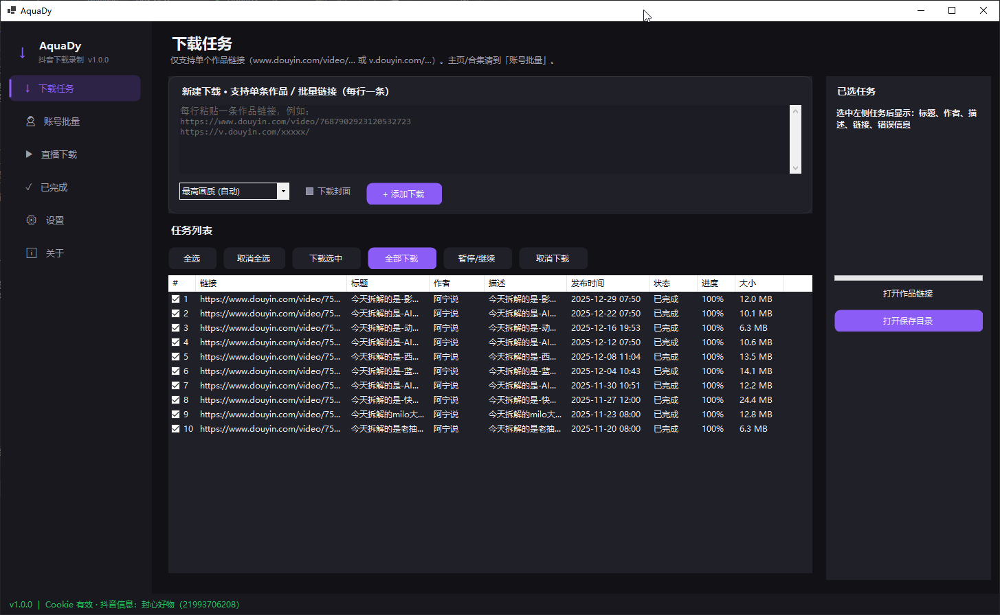
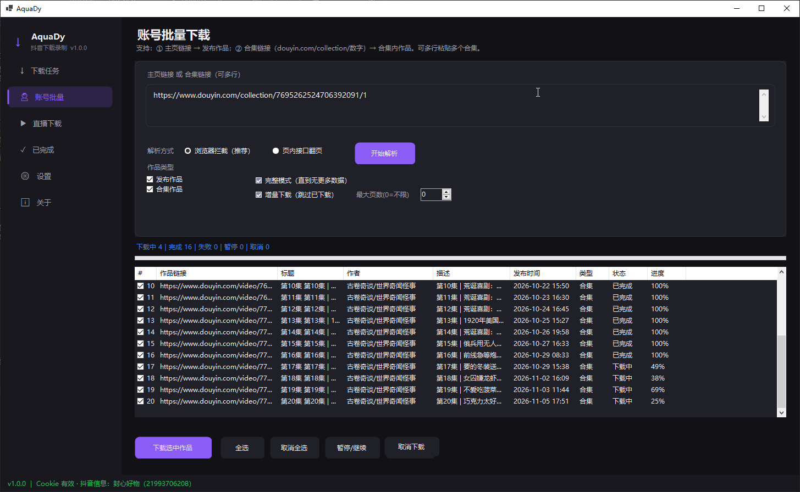
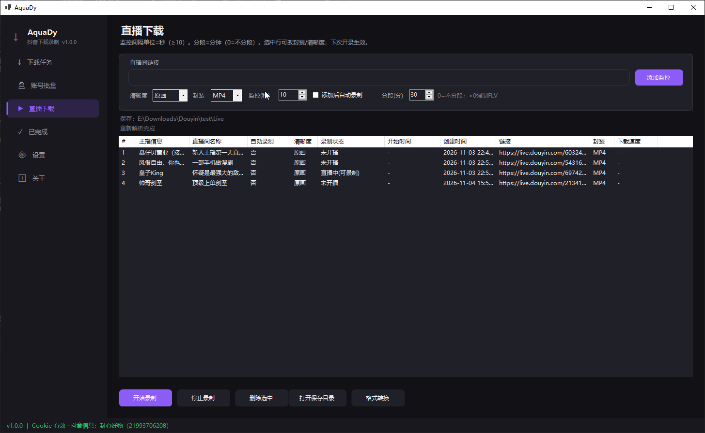
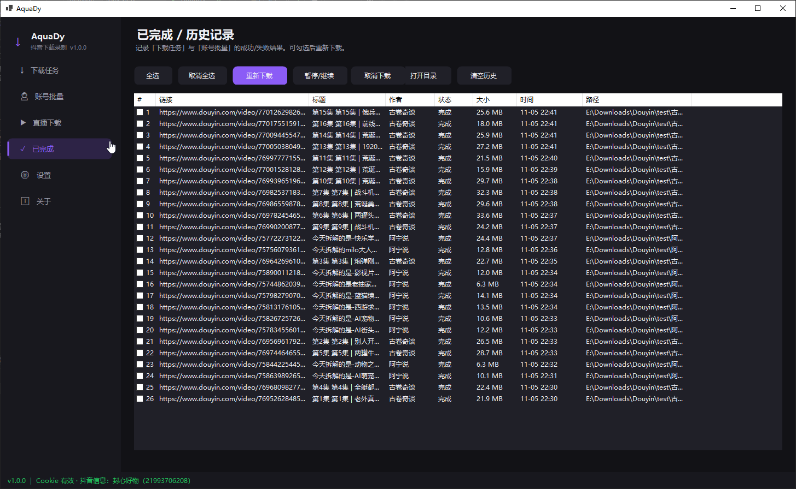
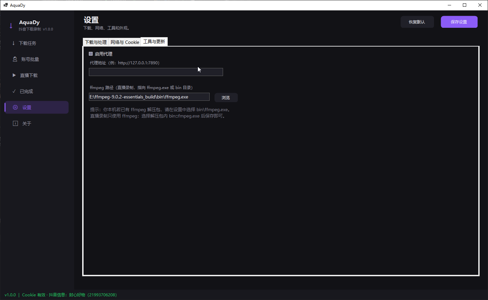

# AquaDy

**AquaDy**（Aqua + Dy）是一款面向 **抖音** 的 Windows 桌面工具：支持作品下载、主页/合集批量解析，以及直播间监控录制。

基于 **C# / .NET 8 / WinForms**，深色界面，配置与日志均保存在程序目录，便于绿色解压使用。

> 仅供学习与个人备份。请遵守抖音用户协议与当地法律法规，勿用于商业或侵权用途。

---

## 功能概览

### 下载任务
- 支持单条或多条作品链接（每行一条）
- 解析标题、作者、描述等信息后排队下载
- 优先无水印地址（取决于接口与 Cookie）
- 可选下载封面
- 支持暂停 / 继续（不支持断点续传） / 取消、并发数量设置

### 账号批量
- 解析用户主页作品列表（完整翻页）
- 解析合集链接，列出合集内作品
- 列表勾选后批量下载
- 按 **作者 / 合集名** 自动整理保存目录
- 解析阶段尽量补全描述、发布时间、合集中文名

### 直播录制
- 添加直播间链接并解析主播、房间信息
- 使用本机 **ffmpeg** 录制（可分段）
- 录制功能需指定ffmpeg程序，需要自行下载，[FFmpeg文件地址](https://www.gyan.dev/ffmpeg/builds/ffmpeg-release-essentials.7z) 文件信息：34 MB .ver .sha256
- 监控间隔、清晰度等基础选项

### 已完成
- 记录成功 / 失败任务
- 支持重新下载、打开目录等

### 设置
- 抖音 Cookie（核心，影响解析与无水印）
- 下载目录、并发数、是否按作者建目录
- 默认是否下载封面
- 操作日志开关（程序目录 `log/`）

---

### 界面展示






---

## 环境要求

- Windows 10/11
- [.NET 8 桌面运行时](https://dotnet.microsoft.com/download/dotnet/8.0)（若发布为框架依赖版）
- 直播录制需自行准备 **ffmpeg**，并在设置中指定路径
- 首次解析主页/合集可能用到 **WebView2**（一般随 Edge 已安装）

---

## 快速开始

1. 解压或克隆本仓库，用 Visual Studio 2022 打开 `AquaDy.sln`，编译运行。
2. 打开 **设置**，粘贴有效的抖音网页 Cookie（浏览器登录抖音后复制）。
3. 建议点击 Cookie 相关校验，确认昵称/抖音号显示正常。
4. **下载任务**：粘贴作品链接 → 添加 → 下载。  
   **账号批量**：粘贴主页或合集链接 → 开始解析 → 勾选 → 下载选中。
5. 直播：在直播页添加房间链接，配置 ffmpeg 后开始录制。

### Cookie 说明

参考开源项目：TikTokDownloader 的cookie获取方式，[ 点击查看 TikTokDownloader ](https://github.com/JoeanAmier/TikTokDownloader/blob/master/docs/Cookie%E8%8E%B7%E5%8F%96%E6%95%99%E7%A8%8B.md) 

---

## 目录结构（运行后）

```
AquaDy/
├── AquaDy.exe          # 主程序
├── config/             # 设置、下载历史、直播间列表
│   ├── settings.json
│   ├── history.json
│   └── live_rooms.json
└── log/                # 可选操作日志（设置中可关闭）
```

配置默认在**程序目录**下的 `config/`，不强制写入系统用户目录。

---

## 从源码构建

```bash
dotnet build AquaDy/AquaDy.csproj -c Release
```

或使用 Visual Studio：打开解决方案 → 还原 NuGet → 生成。

主要依赖：
- Newtonsoft.Json
- Microsoft.Web.WebView2

---

## 版本

当前公开版本：**v1.0.0**

本项目由个人在复刻与改进抖音下载工具的过程中整理而成，公开仓库以 **1.0.0** 作为首个正式版本，便于语义化版本管理。此前的私有迭代仅作开发过程，不再逐条罗列。

---

## 参考与致谢

实现过程中参考了以下开源思路与接口用法（排名不分先后）：

- [JoeanAmier/TikTokDownloader](https://github.com/JoeanAmier/TikTokDownloader) — 作品/合集字段与下载流程
- [Johnserf-Seed/TikTokDownload (F2)](https://github.com/Johnserf-Seed/TikTokDownload) — Web 接口参数参考
- 社区中若干抖音解析、批量下载与直播录制项目

---

## 免责声明

- 本软件与字节跳动 / 抖音官方无关。
- 下载与录制内容版权归原作者及平台所有，请仅用于合法的个人学习与备份。
- 使用本软件所产生的任何后果由使用者自行承担。
